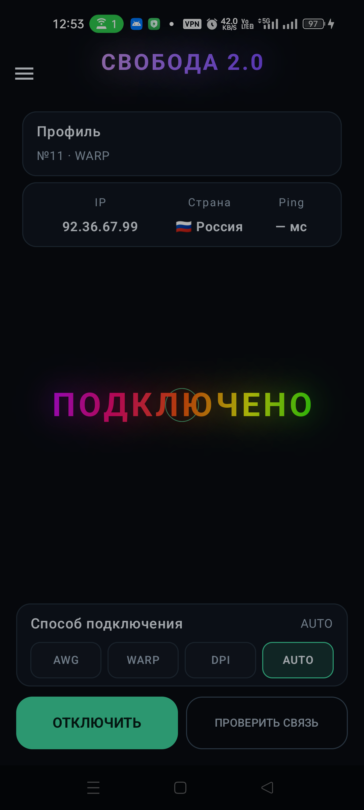
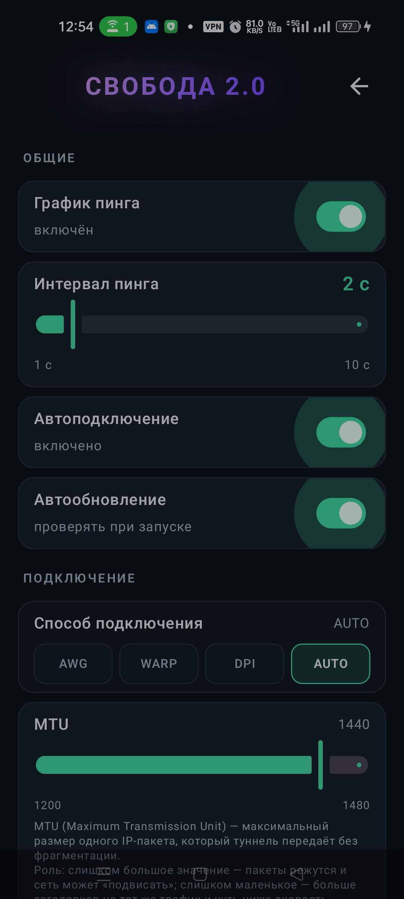
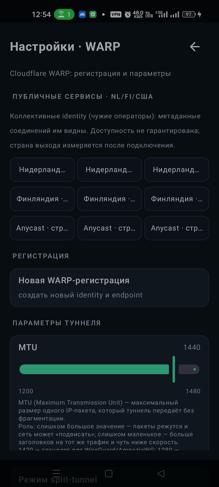
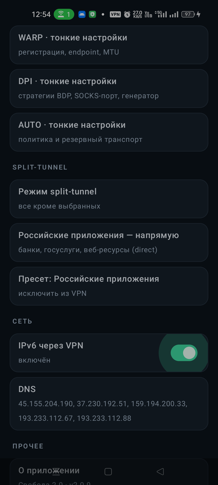

# Свобода 2.0

Android-клиент для доступа в интернет без root и без «отваливания» российских сервисов.
Три независимых транспорта — **AmneziaWG**, **Cloudflare WARP**, **DPI-обход** — плюс
**AUTO**: автоматический выбор работающего канала с проверкой, что интернет реально идёт.

`svoboda.runet.abonent0007` · minSdk 26 · targetSdk 35 · arm64-v8a + armeabi-v7a · версия 2.0.9

---

## Что это и зачем

Проблема не в том, что «VPN не работает», а в том, что блокировки (DPI/TSPU) режут
конкретные ресурсы, и обычный VPN при этом или не помогает, или рубит всё подряд —
включая банки, госуслуги и локальные сервисы, которым зарубежный IP не нужен.

«Свобода 2.0» решает две задачи сразу:

1. **Доступ** — интернет работает там, где сейчас не работает (YouTube, Telegram, Gemini, ChatGPT и т.п.).
2. **Сохранение доступа к своим** — банки, госуслуги, маркетплейсы, локальные сервисы идут **напрямую**, без VPN.

Никакого root, никакого «принять все риски»: только разрешения `VpnService` и
per-app split-tunnel.

---

## Возможности

- **Транспорт на выбор.**
  - **AmneziaWG** — свои серверы (импорт `.conf`, генератор конфигурации с новыми ключами).
  - **WARP** — регистрация и генерация профилей через Cloudflare API, пул anycast-endpoint'ов.
  - **DPI** — локальный обход на ciadpi + tun2socks (HEV), каталог стратегий, SOCKS-порт.
- **AUTO** — автоматический выбор транспорта по порядку (AWG → WARP → DPI), с проверкой
  data plane и резервным переключением при отказе; ложный `CONNECTED` исключён.
- **Раздельное туннелирование.** Режимы «весь трафик», «только выбранные», «все кроме выбранных»;
  глобальный список **«напрямую»** (банки, госуслуги, сервисы) — один на все методы.
  При первом запуске в список уже попадают установленные российские приложения.
- **Списки приложений-спойлеры**: поиск по названию/пакету, все установленные приложения,
  мгновенное переключение; выбранное в одном списке неактивно в другом.
- **Честные статусы.** `CONNECTED` ставится только при подтверждённом HTTPS через туннель;
  при частичной деградации — `LIMITED`/`DEGRADED`, а не тишина.
- **Заметки по стабильности.** На главном экране — пульс состояния; анимация подключения
  яркая, неоновая; кольца-индикаторы.
- **Безопасность.** Конфиги профилей шифруются AES-256-GCM через Android Keystore;
  `allowBackup=false`; список приложений не покидает устройство.
- **Автообновление** из GitHub Releases (отключается в меню).

---

## MTU — почему это ключевая настройка

**MTU (Maximum Transmission Unit)** — максимальный размер одного IP-пакета, который туннель
передаёт без фрагментации. Это не косметика, а рабочий рычаг:

- **Обход блокировок.** Технические средства противодействия угрозам (TSPU) анализируют
  размеры и тайминги пакетов. Изменение MTU — один из реально работающих способов
  обойти часть типов блокировок.
- **«Зависание» трафика.** Слишком большой MTU → пакеты режутся и не собираются →
  сеть «подвисает» при formalально живом туннеле. Слишком маленький → больше заголовков
  на тот же трафик и просадка скорости.

Поэтому цель — **обходить блокировки без зависания**: подбирать MTU под конкретную сеть.
В приложении это ручка **1200–1480** с пресетами 1380–1480 и подсказкой на экране;
по умолчанию 1440, 1420 — стандарт для WireGuard/AmneziaWG, 1280 — безопасный минимум (RFC 4821).

---

## Установка

1. Скачайте APK из **GitHub Releases** (`app-arm64-v8a-release.apk` для современных устройств,
   `app-universal-release.apk` —  universal). Подпись — debug.
2. Разрешите установку из неизвестных источников; при первом подключении — разрешите VPN.
3. Первый запуск: метод **AUTO**, автоподключение включено; при желании откройте шторку
   (`☰`) и проверьте список **«напрямую»** — там уже стоят ваши российские приложения.

## Скриншоты

| Главный экран | Меню |
|---|---|
|  |  |

| Настройки WARP | Настройки DPI |
|---|---|
|  |  |

## Диагностика

- `auto_log.txt` в файлах приложения — журнал AUTO/подключений.
- `adb logcat -s SvobodaVpn` — технический лог.
- Кнопка **«Проверить связь»** — честная проверка выхода через туннель.

## Сборка

```bat
set JAVA_HOME=C:\path\to\jdk17
set PATH=%JAVA_HOME%\bin;C:\path\to\go\bin;C:\path\to\git\cmd;C:\path\to\git\usr\bin;C:\path\to\mingw64\bin;%PATH%
gradlew.bat assembleDebug --console=plain --no-daemon
```

> `git\usr\bin` и `mingw64\bin` обязательны: без них NDK make падает на `uname -m`.

## Тесты

`gradlew.bat :app:testDebugUnitTest` — 66 тестов (Vpn/Anti-bounce/quarantine, RemoteConfig, стратегии).

## Статус

Текущая версия — **2.0.9** (versionCode 209). Релизы публикуются на GitHub.
